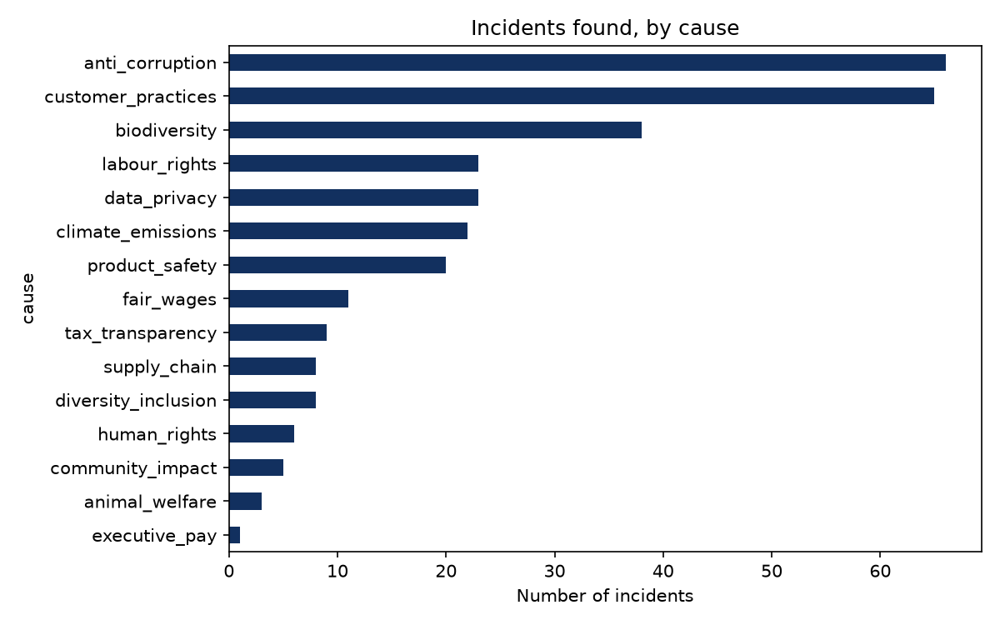

# Ethos: an AI adviser for ethical investing

**Invest with purpose. Grow with confidence.**

Ethos helps charities and ethical institutions, such as law firms, decide where to invest. It interviews the client, screens
UK-listed companies against their rules, rates the rest on cited evidence of real incidents, and builds a portfolio with a
reason for every holding and for every company left out.

Built by a team of three for the **Microsoft x LSEG London Hackathon 2026**. This is my copy of the team repository
([rayhanmanoly/msft-lseg-hack](https://github.com/rayhanmanoly/msft-lseg-hack)), shared with the team's agreement, where I continue
the data analysis side of the project.

## How it works

1. **Intake.** A chat with Ethos turns the client's own words into a structured profile: risk level, excluded sectors and
   activities, and the causes they care about, each with a strength.
2. **Screen.** Rules on sector and activity remove companies (332 down to about 107 for a typical client).
3. **Ethics check.** Each remaining company is rated from dated, cited incidents using a scoring rubric. Companies without
   enough evidence are marked "not rated", never treated as clean.
4. **Allocation.** A portfolio optimiser picks weights inside a risk budget set by the client's investment horizon.
5. **Report.** A calm one-page report with the summary first and every detail one click away.

## Who did what

| Person | Work |
|---|---|
| **Amir (me)** | Frontend and report design in Next.js and React. The chat intake flow and editable steps. The ethics-scoring rubric, tuned against the real evidence data. The landing and About pages. The data analysis in [`analysis/`](analysis/). |
| **Rayhan Manoly** | Pipeline and orchestration, the API routes, the evidence cache (110 researched companies with cited sources), and the shared data contracts. |
| **Kenza Driss** | Financial side: market data from daily prices, expected returns and risk, and the portfolio optimisation with three horizon options. |

## What I am working on now

Independent analysis of the evidence data, in Python and pandas, in [`analysis/`](analysis/):

- [x] **Step 1.** Incident counts by cause and by sector, as rates per researched company. ([`01_incidents.py`](analysis/01_incidents.py))
- [ ] **Step 2.** How sensitive the exclusion rubric is: how many companies change outcome when the thresholds move.
- [ ] **Step 3.** Price data: returns, volatility and correlations.
- [ ] **Step 4.** A backtest of the three horizon portfolios against the FTSE 100.
- [ ] **Step 5.** My own additional dataset, compared with the Ethos ratings.
- [ ] **Step 6.** The same queries in SQL.

**First findings (Step 1):** 308 incidents across 80 of 110 researched companies, 58% confirmed. Anti-corruption and
customer-practice problems are the most common causes. Energy has the most incidents per researched company (4.75). These
reflect what was found and cited in the AI-assisted research pass, not the true number of incidents, and small sectors such
as Real Estate have too few companies for reliable rates.



## Honest limits

- Evidence covers 110 of 332 companies. The rest are marked "not rated".
- Incident severity and scale come from an AI research pass, and the rubric thresholds are a judgement call.
- Expected returns are assumptions (shrunk toward a 4.5% equity premium), not forecasts.
- Educational prototype. Not financial advice.

## Run it

```bash
npm install
cp .env.example .env     # add AZURE_OPENAI_API_KEY for the chat
npm run dev              # http://localhost:3000
```

For the analysis:

```bash
python3 -m venv analysis/.venv && analysis/.venv/bin/pip install pandas matplotlib
analysis/.venv/bin/python analysis/01_incidents.py
```

Team documentation: [docs/TEAM_REFERENCE.md](docs/TEAM_REFERENCE.md), current status in [CONTEXT.md](CONTEXT.md).
