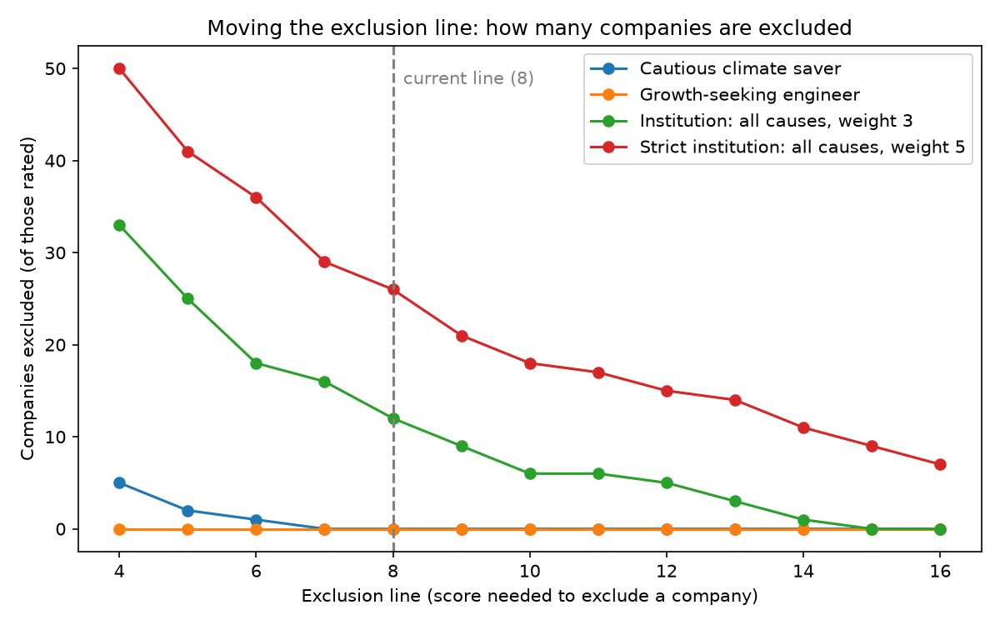
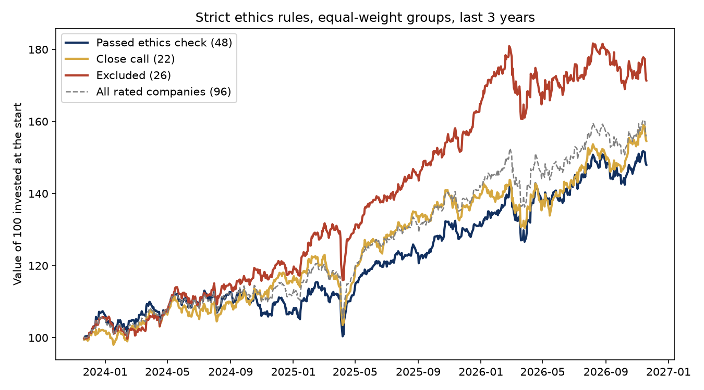

# Does an ethical screen cost returns? Evidence from 96 FTSE 100 companies

**Amir** · Python, pandas, SQL · Code: [`analysis/`](.) · Data period: Nov 2023 to Nov 2026

## Question

Ethos, a hackathon project I worked on, screens UK companies for ethical charities using a scoring rule on cited incidents (fraud, pollution, mis-selling and so on). Two questions came out of it:

1. **How much do the rule's settings decide who gets excluded?**
2. **Did excluding those companies cost money over the last three years?**

## Data

- **Evidence:** 110 researched companies with 308 dated incidents, each with severity, whether confirmed, and how much was fixed. Collected by a teammate using an AI research pass.
- **Prices:** daily closing prices for 97 FTSE 100 companies, 760 trading days, which I downloaded myself.
- **Method:** I rebuilt the scoring rule in Python and checked it against the app's production code. It gave identical results.

## Findings

**1. The cut-off decides the outcome.** For an institution that cares about every cause, the current exclusion line excludes 12 of 107 rated companies. A stricter line excludes 18 (+50%), and a looser one excludes 6 (half). How fast old incidents fade also matters (it changes the outcome of 10 to 13 companies), while the weight given to unproven allegations barely does (2 to 3 companies).

**2. In this window the excluded companies returned more.** Holding each group in equal parts over three years:

| Group | Companies | Return a year | Volatility | Worst fall |
|---|---|---|---|---|
| Passed the ethics check | 48 | 13.9% | 12.8% | -13.0% |
| Excluded | 26 | 19.6% | 12.9% | -12.0% |

Risk was the same, but the passed group returned 5.7 points a year less.

**3. That gap is not clearly more than luck.** Random groups of 26 companies returned between 11.1% and 20.3% a year. The excluded group beat 92% of them: high, but not extreme.

**Diversification still works.** Typical portfolio volatility is 26% with one company, 14% with ten and 12% with forty, so adding holdings beyond 10 to 15 gives little extra protection.

## Limits

- **Look-ahead bias:** the incidents known today are applied to past prices. An investor in 2023 would not have had them.
- **Short, narrow window:** three years, and the excluded group may lean towards sectors that did well in this period.
- **Data quality:** severity and scale come from an AI research pass. Only 107 of 332 companies have full evidence.
- **Not the app's portfolios:** equal weights, not the optimised ones. Past returns are not forecasts.

## What this means for a client

A charity using a strict screen should expect a possible return drag of a few points a year in a period like this one, but not a certain one, and about the same risk. Two settings deserve a clear explanation to the client: where the exclusion line sits, and how long an old incident stays against a company.

## Next

A longer price history to test across market conditions, rating the companies as they stood at each date, and a dashboard so a client can move the exclusion line and see the effect.
